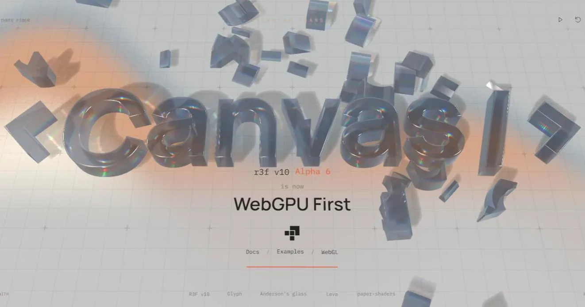

[](https://pmndrs.github.io/examples/r3f-alpha-6)
[](https://codesandbox.io/s/github/pmndrs/examples/tree/main/examples/r3f-alpha-6)
[](https://stackblitz.com/github/pmndrs/examples/tree/main/examples/r3f-alpha-6)

```sh
$ npx degit pmndrs/examples/examples/r3f-alpha-6
```



The React Three Fiber v10 Alpha 6 announcement. It needs a browser with WebGPU and shows a static fallback otherwise.

Source credits are in [`src/CREDITS.md`](src/CREDITS.md).
