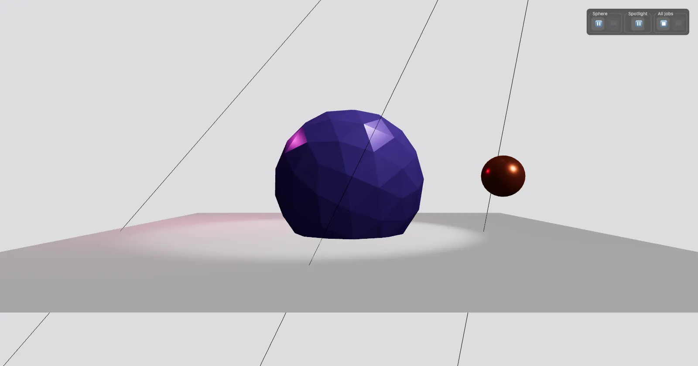

[](https://pmndrs.github.io/examples/use-frame-controls)
[](https://codesandbox.io/s/github/pmndrs/examples/tree/main/examples/use-frame-controls)
[](https://stackblitz.com/github/pmndrs/examples/tree/main/examples/use-frame-controls)

```sh
$ npx degit pmndrs/examples/examples/use-frame-controls
```



The controls useFrame returns. Pause, resume and step a single job, pause another by id through the scheduler, or stop the whole loop and step every job by hand.

Built on React Three Fiber v10 (alpha), which renders with WebGPU. Where the browser has no WebGPU, three's WebGPURenderer falls back to WebGL 2.
