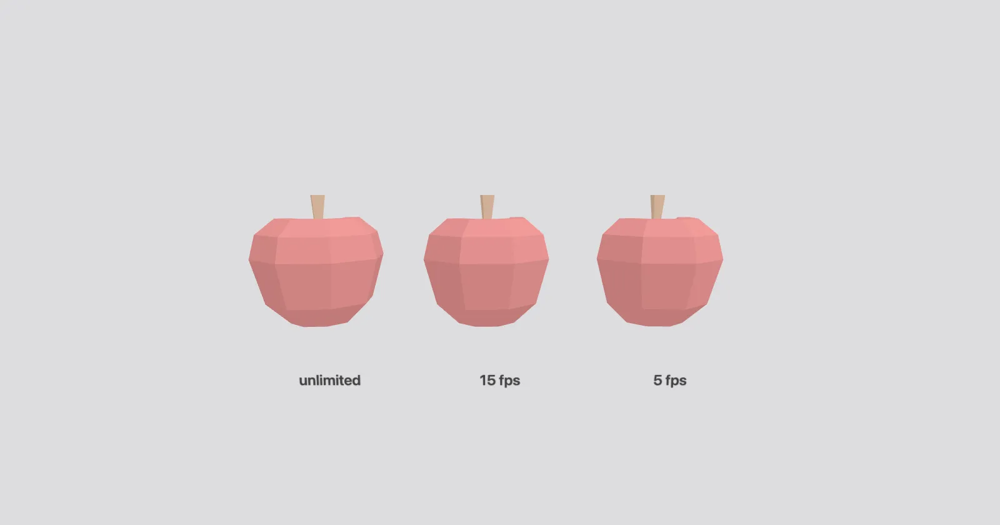

[](https://pmndrs.github.io/examples/use-frame-fps)
[](https://codesandbox.io/s/github/pmndrs/examples/tree/main/examples/use-frame-fps)
[](https://stackblitz.com/github/pmndrs/examples/tree/main/examples/use-frame-fps)

```sh
$ npx degit pmndrs/examples/examples/use-frame-fps
```



Three apples spin at the same speed with different useFrame fps limits: unlimited, 15 and 5. Each job runs at its own rate on one render loop.

Built on React Three Fiber v10 (alpha), which renders with WebGPU. Where the browser has no WebGPU, three's WebGPURenderer falls back to WebGL 2.
