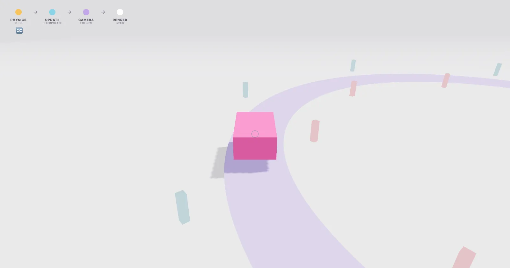

[](https://pmndrs.github.io/examples/use-frame-phases)
[](https://codesandbox.io/s/github/pmndrs/examples/tree/main/examples/use-frame-phases)
[](https://stackblitz.com/github/pmndrs/examples/tree/main/examples/use-frame-phases)

```sh
$ npx degit pmndrs/examples/examples/use-frame-phases
```



Why a follow camera has to run after interpolation. Physics steps at 15 Hz in the fixed physics phase, an update job interpolates it, and a custom camera phase follows. Swap the two and watch the camera stutter.

Built on React Three Fiber v10 (alpha), which renders with WebGPU. Where the browser has no WebGPU, three's WebGPURenderer falls back to WebGL 2.
