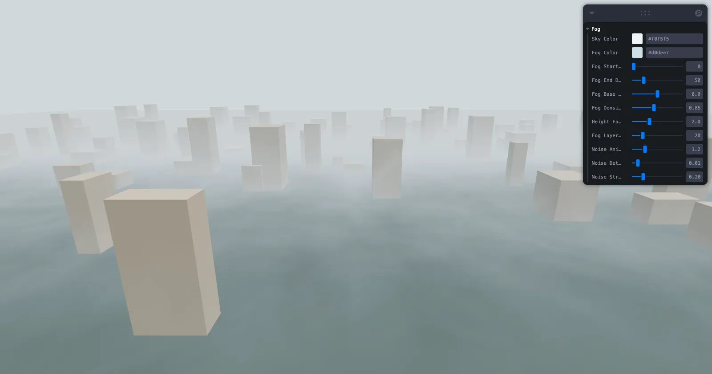

[](https://pmndrs.github.io/examples/webgpu-fog)
[](https://codesandbox.io/s/github/pmndrs/examples/tree/main/examples/webgpu-fog)
[](https://stackblitz.com/github/pmndrs/examples/tree/main/examples/webgpu-fog)

```sh
$ npx degit pmndrs/examples/examples/webgpu-fog
```



Procedural height fog with animated noise, written in TSL. Scoped useUniforms read from Leva, and useLocalNodes installs the fogNode and backgroundNode on the scene. Based on three.js webgpu_custom_fog.

Built on React Three Fiber v10 (alpha), which renders with WebGPU. Where the browser has no WebGPU, three's WebGPURenderer falls back to WebGL 2.
