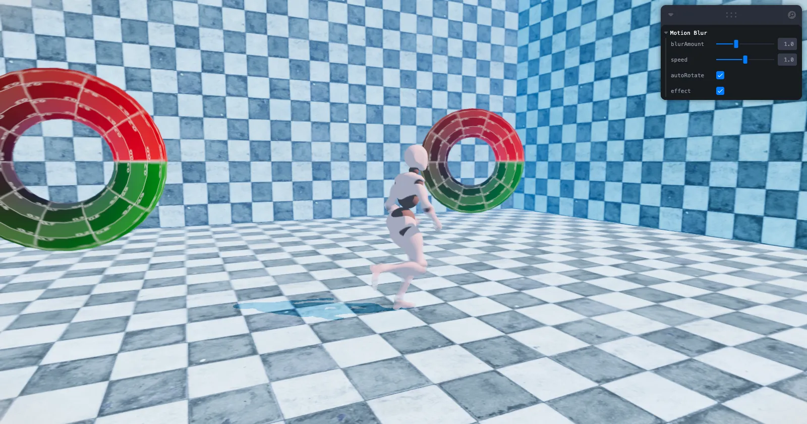

[](https://pmndrs.github.io/examples/webgpu-motion-blur)
[](https://codesandbox.io/s/github/pmndrs/examples/tree/main/examples/webgpu-motion-blur)
[](https://stackblitz.com/github/pmndrs/examples/tree/main/examples/webgpu-motion-blur)

```sh
$ npx degit pmndrs/examples/examples/webgpu-motion-blur
```



Per-object motion blur from a velocity MRT, set up with useRenderPipeline. An animated character and spinning tori show the effect; toggle it and tune the amount from Leva. Based on three.js webgpu_postprocessing_motion_blur.

Built on React Three Fiber v10 (alpha), which renders with WebGPU. Where the browser has no WebGPU, three's WebGPURenderer falls back to WebGL 2.
