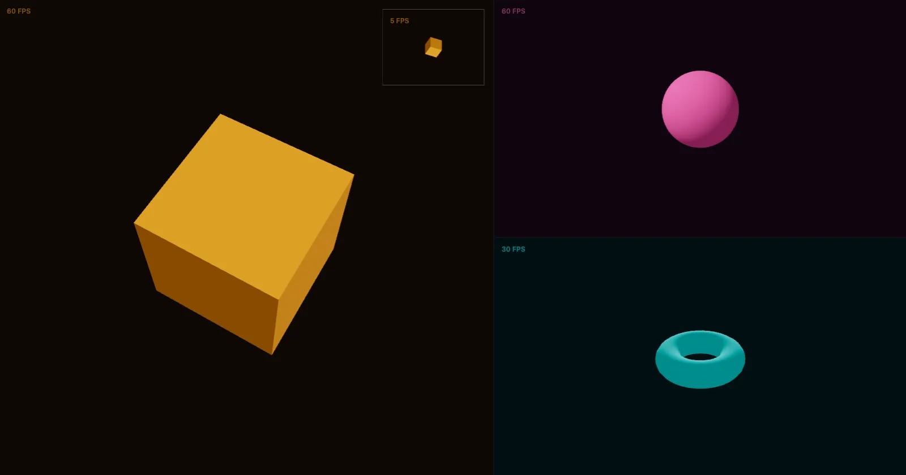

[](https://pmndrs.github.io/examples/webgpu-multi-canvas)
[](https://codesandbox.io/s/github/pmndrs/examples/tree/main/examples/webgpu-multi-canvas)
[](https://stackblitz.com/github/pmndrs/examples/tree/main/examples/webgpu-multi-canvas)

```sh
$ npx degit pmndrs/examples/examples/webgpu-multi-canvas
```



Four canvases, one WebGPU device. The primary canvas owns the renderer and the others share it, each on its own frame rate, and a 5 fps HUD redraws the primary's scene from above with an orthographic camera.

Built on React Three Fiber v10 (alpha), which renders with WebGPU. Where the browser has no WebGPU, three's WebGPURenderer falls back to WebGL 2.
