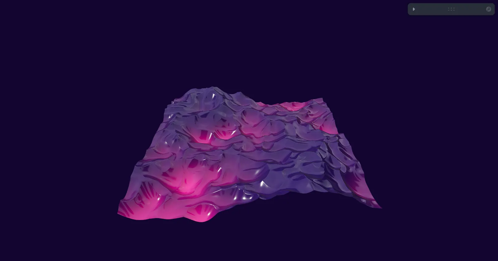

[](https://pmndrs.github.io/examples/webgpu-raging-sea)
[](https://codesandbox.io/s/github/pmndrs/examples/tree/main/examples/webgpu-raging-sea)
[](https://stackblitz.com/github/pmndrs/examples/tree/main/examples/webgpu-raging-sea)

```sh
$ npx degit pmndrs/examples/examples/webgpu-raging-sea
```



The raging sea shader rebuilt in TSL. Leva values become uniforms through useUniforms, and useNodes builds the displacement and color nodes once under a name the material reads back.

Built on React Three Fiber v10 (alpha), which renders with WebGPU. Where the browser has no WebGPU, three's WebGPURenderer falls back to WebGL 2.
