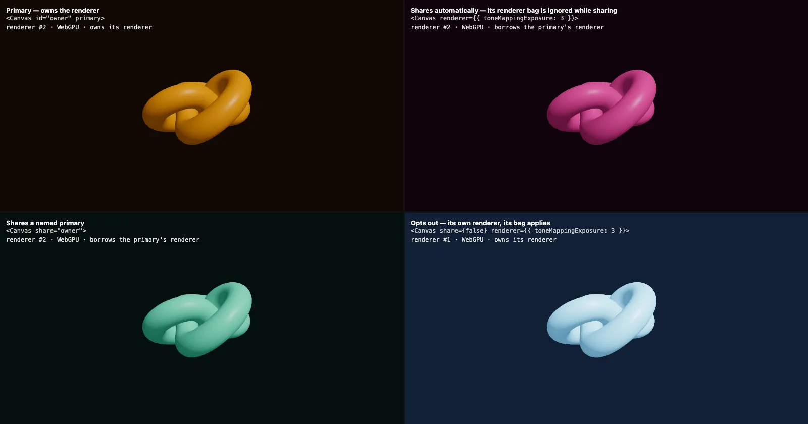

[](https://pmndrs.github.io/examples/webgpu-shared-renderer)
[](https://codesandbox.io/s/github/pmndrs/examples/tree/main/examples/webgpu-shared-renderer)
[](https://stackblitz.com/github/pmndrs/examples/tree/main/examples/webgpu-shared-renderer)

```sh
$ npx degit pmndrs/examples/examples/webgpu-shared-renderer
```



Who owns the renderer when canvases share one: a primary, a canvas that borrows it automatically, one that names it with share="id", and one that opts out with share={false} and builds its own. Each label reads its canvas's state live.

Built on React Three Fiber v10 (alpha), which renders with WebGPU. Where the browser has no WebGPU, three's WebGPURenderer falls back to WebGL 2.
