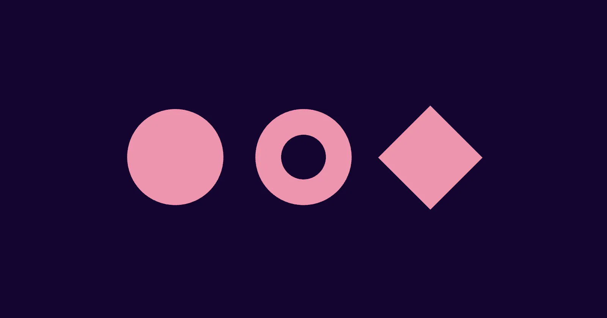

[](https://pmndrs.github.io/examples/webgpu-shared-uniforms)
[](https://codesandbox.io/s/github/pmndrs/examples/tree/main/examples/webgpu-shared-uniforms)
[](https://stackblitz.com/github/pmndrs/examples/tree/main/examples/webgpu-shared-uniforms)

```sh
$ npx degit pmndrs/examples/examples/webgpu-shared-uniforms
```



One TSL graph drives three shapes. useUniform and useUniforms register named uniforms on the root, useNodes builds the color and position nodes from them, and a hover springs one uniform without rebuilding anything.

Built on React Three Fiber v10 (alpha), which renders with WebGPU. Where the browser has no WebGPU, three's WebGPURenderer falls back to WebGL 2.
