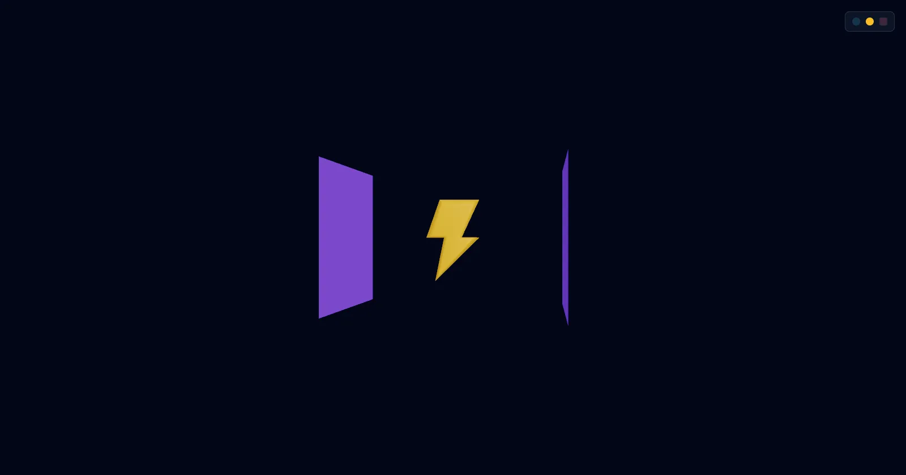

[](https://pmndrs.github.io/examples/webgpu-visibility-events)
[](https://codesandbox.io/s/github/pmndrs/examples/tree/main/examples/webgpu-visibility-events)
[](https://stackblitz.com/github/pmndrs/examples/tree/main/examples/webgpu-visibility-events)

```sh
$ npx degit pmndrs/examples/examples/webgpu-visibility-events
```



onFramed, onOccluded and onVisible on WebGPU. A sphere orbits in and out of view and behind panels, and each object recolors through a TSL uniform as its visibility changes.

Built on React Three Fiber v10 (alpha), which renders with WebGPU. Where the browser has no WebGPU, three's WebGPURenderer falls back to WebGL 2.
